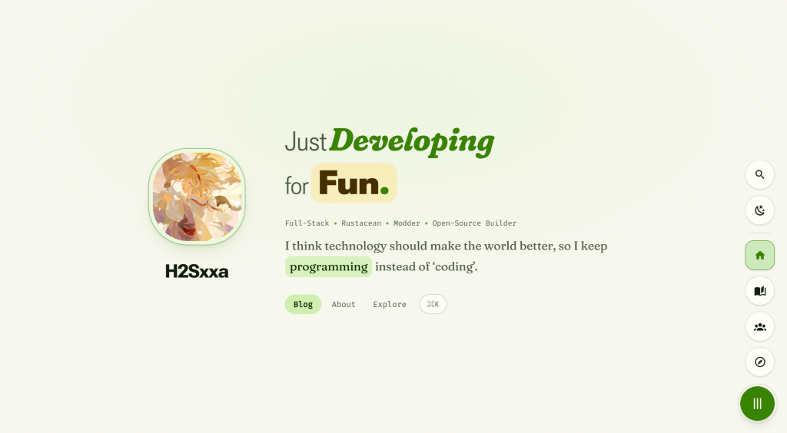
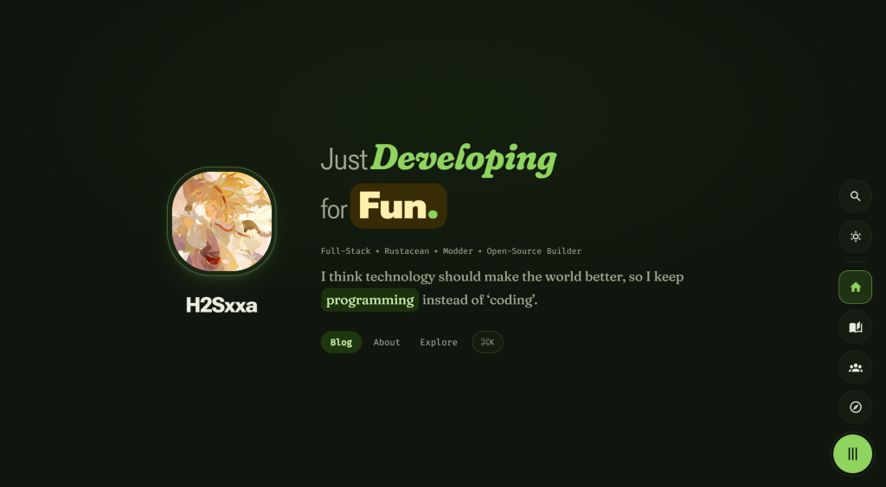
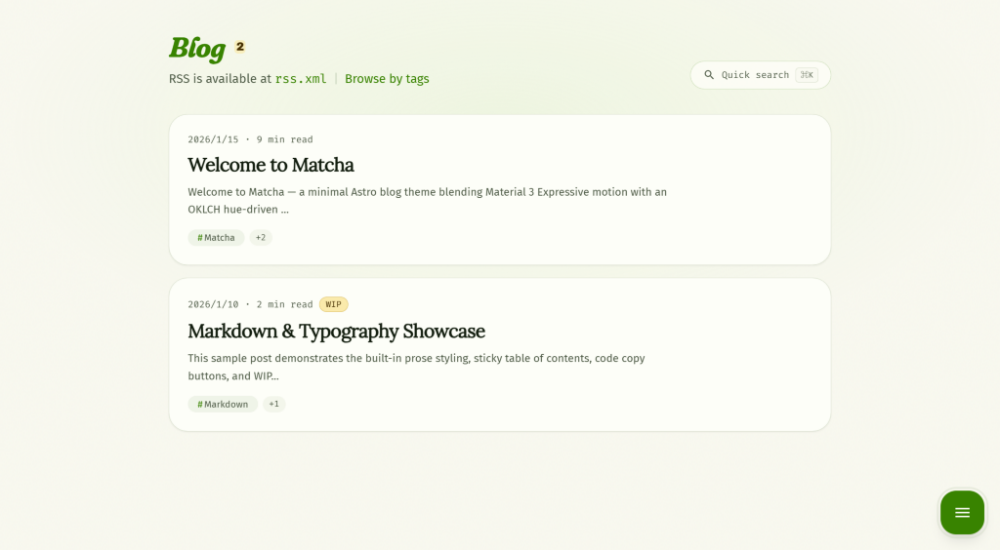
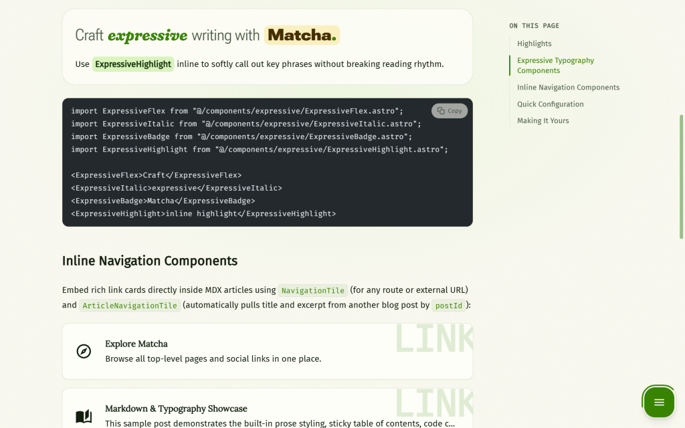
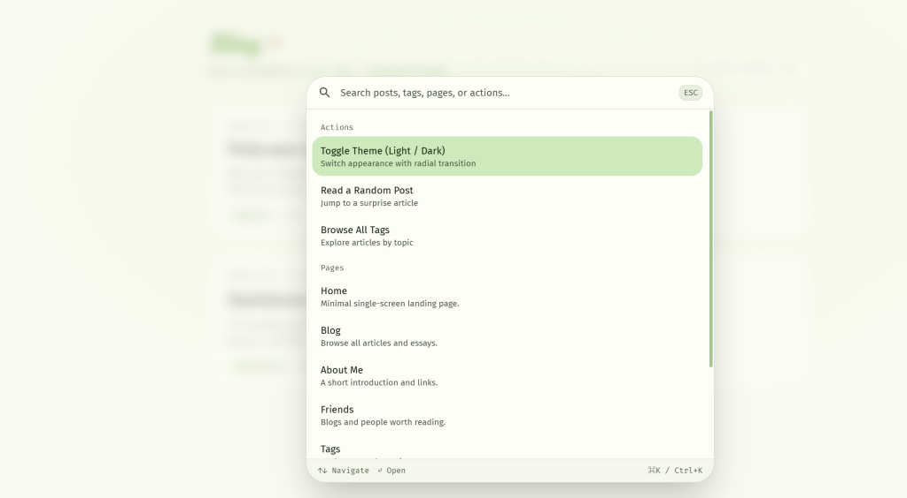

# astro-theme-matcha

A minimal Astro blog theme inspired by **Material 3 Expressive** motion and warm paper typography, powered by an **OKLCH hue-driven** color system.

## Showcase

| Light Home | Dark Home |
| --- | --- |
|  |  |

| Blog List | Article Reader & MDX Components |
| --- | --- |
|  |  |

| Command Palette (`⌘K`) |
| --- |
|  |

## Features

- **Material 3 Expressive Motion**: Variable fonts (`Roboto Flex` + `Fraunces`), spring shape morphing, 4-band staggered route curtains, and radial View Transition dark-mode ripples.
- **OKLCH Hue Theming**: Change a single `theme.hue` number in `src/site.config.ts` to recolor the entire site and Giscus comment themes simultaneously.
- **Clean Configuration**: Strictly typed `src/site.config.ts` (types in `src/types/config.ts`) while keeping pages directly editable for effortless customization.
- **Built-in Reading Experience**: Sticky sliding-rail TOC, code block copy buttons, image lightbox, `⌘K` command palette, floating action button with reading progress ring, RSS feed, sitemap, and dynamic `robots.txt`.

## Getting Started

```bash
pnpm install
pnpm dev
```

Build for static deployment (GitHub Pages, Cloudflare Pages, Netlify, Vercel):

```bash
pnpm build
```

## Configuration

1. Update `site` in `astro.config.mjs` to your production URL.
2. Edit `src/site.config.ts` to configure:
   - `site`: title, description, `lang`, `dateLocale`, optional `ogImage`
   - `author`: name, bio, avatar, roles, social links
   - `navigation`: `fab`, `explore`, `friends`, and top-level `routes` (for curtain transitions)
   - `blog`: `pageSize`
   - `commandPalette`: `enabled`, `placeholder`, `resultLimit`, extra `links`
   - `comments`: Giscus config object or `false` to disable
   - `theme`: `defaultTheme` (`"system" | "light" | "dark"`), `hue` (`0`–`360`, default `137`), optional `tertiaryHue`
3. Replace sample posts in `src/content/blog/` and customize `src/pages/index.astro` or `src/pages/about.mdx` directly.

## Project Structure

```text
src/
├── components/        # UI & expressive typography components
├── content/blog/      # Markdown & MDX blog posts
├── layouts/           # BaseLayout
├── pages/             # Routes + dynamic robots.txt / giscus-*.css / rss.xml
├── scripts/           # Client enhancements (FAB, CommandPalette, TOC, Curtain)
├── styles/            # Modular Tailwind v4 + OKLCH tokens
├── types/config.ts    # TypeScript config definitions
└── site.config.ts     # Main site configuration
```
